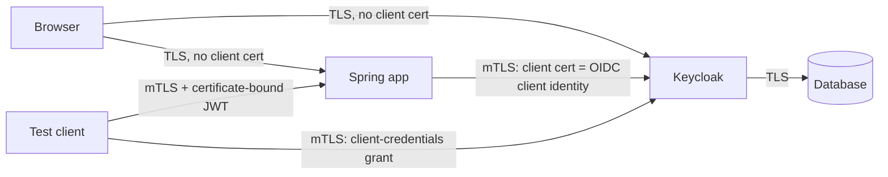
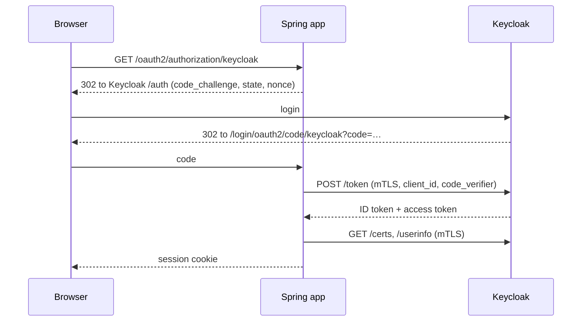
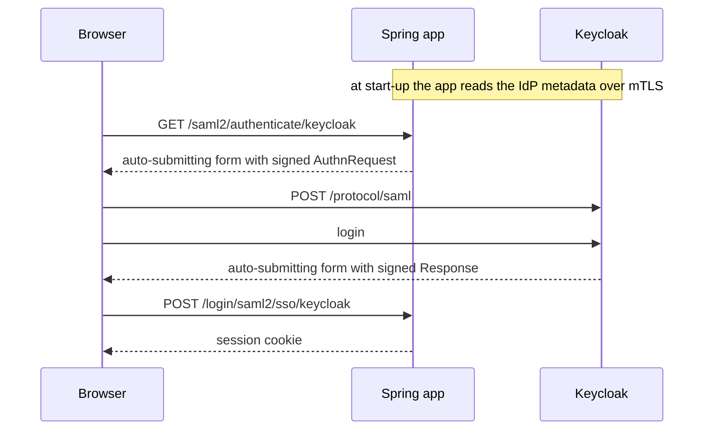

# 1. Architecture

## Components

| Component | Workload | Image | Ports |
|---|---|---|---|
| Keycloak 26.8 | StatefulSet `<release>-keycloak` | `iam-platform/keycloak` | 8443 HTTPS (mTLS "request"), 9000 management (health, metrics), 7800/57800 cluster |
| Spring Boot app (Java 25) | Deployment `<release>-spring-app` | `iam-platform/spring-app` | 8443 HTTPS (mTLS "want"), 9443 management (actuator health) |
| Test client (Java 25) | `helm test` pod `<release>-test-client`, also the app's init container | `iam-platform/test-client` | none (outbound only) |

Everything speaks TLS 1.3 (1.2 allowed). There is no plain-HTTP listener anywhere.

## Trust model

One private CA issues every certificate. Each workload gets three PEM files,
always at the same paths:

```
/etc/platform/tls/tls.crt   its certificate
/etc/platform/tls/tls.key   its private key (PKCS#8)
/etc/platform/tls/ca.crt    the CA it trusts
```

| Certificate | Subject | Usage | Used for |
|---|---|---|---|
| keycloak | `CN=keycloak,OU=…,O=…,C=…` | server | Keycloak HTTPS |
| spring-app | `CN=spring-app,…` | server + client | app HTTPS; client certificate towards Keycloak |
| test-client | `CN=test-client,…` | client | client certificate towards Keycloak and the app |
| saml-sp | `CN=saml-sp,…` (RSA) | signing | signs SAML AuthnRequests |

Trust is deliberately narrow: workloads trust **only** this CA for platform
traffic, not the public roots.

## Who authenticates to whom, and how



| Connection | TLS | Who proves what |
|---|---|---|
| Browser → Keycloak / app | server-auth TLS | Server proves identity with its certificate. Users log in interactively; they have no client certificate, which is why both servers *request* rather than *require* one. |
| App → Keycloak (token, JWKS, userinfo, SAML metadata) | mutual TLS | The app's certificate **is** its OIDC client credential (`tls_client_auth`, RFC 8705). Keycloak compares subject and issuer DN with the client configuration. |
| Test client → Keycloak | mutual TLS | Same mechanism, client-credentials grant. The access token is bound to the certificate (`cnf.x5t#S256`). |
| API caller → app `/api/**` | mutual TLS | Caller must present a certificate from the CA **and** a valid JWT with the required role; a bound token must match the presented certificate. |
| kubelet → management ports | server-auth TLS | Probes cannot present a certificate, so management ports ask for none and expose only health (and metrics on Keycloak). NetworkPolicies limit who can reach them. |

### Why "request / want" and not "require / need"

Requiring a client certificate at the TLS layer would lock browsers out of the
login pages. Instead:

- Keycloak is built with `https-client-auth=request`. Confidential clients
  are configured with the *X.509 certificate* authenticator, so a token
  request without the right certificate is rejected (`invalid_client`).
- The app runs with `client-auth: want`. `/api/**` adds an authorization rule
  that insists on a client certificate, so API calls without one get 403.

Both can be tightened (`KC_HTTPS_CLIENT_AUTH=required`, `app.clientAuth=need`)
when every caller, including your ingress, presents a certificate.

## Login flows

**OpenID Connect** (authorization code + PKCE):



**SAML 2.0** (SP-initiated, POST binding):



## Public and internal URLs

Two base URLs exist for each service:

- **internal** - the Kubernetes Service, e.g.
  `https://iam-keycloak.iam.svc.cluster.local:8443`. Used for all
  back-channel calls.
- **public** - what browsers use, e.g. `https://sso.example.com`. It is the
  `iss` of every token and the SAML entity ID.

By default public = internal, which is enough for service-to-service use and
for the test pod. Set `KC_PUBLIC_URL` / `APP_PUBLIC_URL` (or
`keycloak.publicUrl` / `app.publicUrl`) when you expose them; Keycloak then
runs with `hostname-backchannel-dynamic=true` so in-cluster calls keep using
the Service.

## What runs where in the pipeline

| Stage | Command | Produces |
|---|---|---|
| Certificates | `platform.sh certs` | `build/certs/**` |
| Images | `platform.sh build` | 3 local images, `build/images.env` |
| Publish | `platform.sh push` | images in ACR, `build/images.pushed.env` (digests) |
| Secrets | `platform.sh secrets` | namespace, 4 TLS Secrets, admin Secret |
| Deploy | `platform.sh deploy` | `build/helm-values.generated.yaml`, Helm release |
| Test | `platform.sh test` | test pod report (25 checks) |
